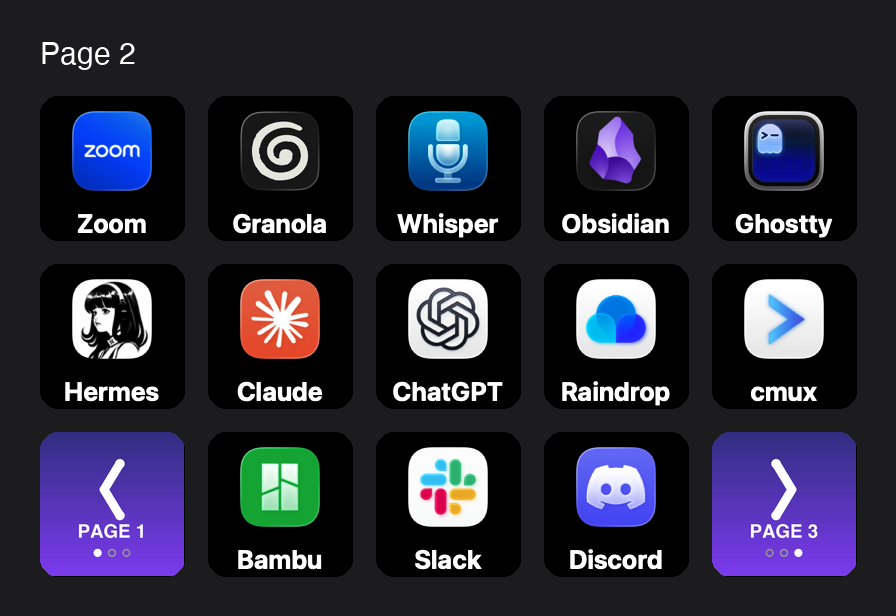

# Stream Deck

An Elgato Stream Deck provides hardware buttons for lights, media, and
shortcuts. Two devices are connected:

| Device | Model | Buttons | Connected to |
| ------ | ----- | ------- | ------------ |
| Stream Deck (15-key) | 20GAA9902 | 5 × 3 grid | mini, studio |
| Stream Deck Pedal (3-key) | 20GBF9901 | 3 × 1 strip | studio |

## Profiles

The 15-key deck switches between profiles with a dedicated button:

| Profile | Purpose |
| ------- | ------- |
| **Meetings** | Lights (Elgato Key Light, Philips Hue), mute toggle, media controls, sleep |
| **AV Setup** | Light temperature and brightness, media, CPU monitor |
| **Profile 1** | Hotkeys for window management |

The 3-key deck uses a single **Default Profile** with desk lights, mute
toggle, and media.

## Mac Studio launcher page

On the Mac Studio, page 2 of the 15-key deck's default profile is an app
launcher. Each key opens an app from `/Applications`. The bottom corners
switch pages and wrap around between pages 1 and 3.



| Row | Keys |
| --- | ---- |
| Top | Zoom, Granola, MacWhisper, Obsidian, Ghostty |
| Middle | Hermes, Claude, ChatGPT, Raindrop.io, cmux |
| Bottom | Previous page, Bambu Studio, Slack, Discord, Next page |

The page is defined as a JSON spec (`layouts/mk2-page2.json`) and
written to the Stream Deck app's profile by scripts in
`~/Projects/stream-deck`, not built by hand in the app:

| Script | Purpose |
| ------ | ------- |
| `scripts/sdconfig.py` | Dump, export, and apply page layouts to the app's profiles (stdlib only) |
| `scripts/keyicon.py` | Render a key image from an app's icon with the label baked in (pyobjc) |
| `scripts/navicon.py` | Draw the page navigation keys: chevron, target page, page dots (Pillow) |

All three are PEP 723 scripts, so they run with `uv run`:

```shell
cd ~/Projects/stream-deck
uv run scripts/sdconfig.py export --page DFE14820 \
    --like layouts/mk2-page2.json --out layouts/mk2-page2.json
uv run scripts/sdconfig.py apply layouts/mk2-page2.json            # dry run
uv run scripts/sdconfig.py apply layouts/mk2-page2.json --apply    # write
```

`apply` is a dry run unless you pass `--apply`. Before it writes, it
backs up the profile to `.sdconfig-backups/` outside `ProfilesV3/`. It
won't write while the Stream Deck app is running (see below).

## Editing profiles

The Elgato Stream Deck app owns the config files under
`~/Library/Application Support/com.elgato.StreamDeck/ProfilesV3/`. Each
`.sdProfile` directory contains a `manifest.json` and per-page manifests
under `Profiles/`.

The app writes its in-memory state back to disk, so edits made while it
is running are silently reverted. To edit the JSON directly:

```shell
osascript -e 'quit app "Elgato Stream Deck"'
# ... edit the manifest.json ...
open -a "Elgato Stream Deck"
```

## Button grid coordinates

Keys in the manifest use `"col,row"` coordinates (zero-indexed,
origin at top-left):

```
0,0  1,0  2,0  3,0  4,0    ← top row
0,1  1,1  2,1  3,1  4,1    ← middle row
0,2  1,2  2,2  3,2  4,2    ← bottom row
```

## Common action UUIDs

| Action | UUID | Settings |
| ------ | ---- | -------- |
| Key Light on/off | `com.elgato.controlcenter.lights-on-off` | `deviceID`, `name` |
| Philips Hue on/off | `com.elgato.philips-hue.power` | `bridge`, `light` |
| Philips Hue scene | `com.elgato.philips-hue.scene` | `bridge`, `light`, `scene` |
| Philips Hue color | `com.elgato.philips-hue.color` | `bridge`, `light`, `color` |
| Multimedia | `com.elgato.streamdeck.system.multimedia` | `actionIdx` (0=mute, 1=play/pause, 3=prev, 4=next, 5=vol up, 6=vol down) |
| Hotkey | `com.elgato.streamdeck.system.hotkey` | `Hotkeys[]` with key codes |
| Website | `com.elgato.streamdeck.system.website` | `openInBrowser`, `path` |
| Switch Profile | `com.elgato.streamdeck.profile.rotate` | `ProfileUUID` |
| Sleep | `com.elgato.streamdeck.system.sleep` | `DeviceUUID` |
